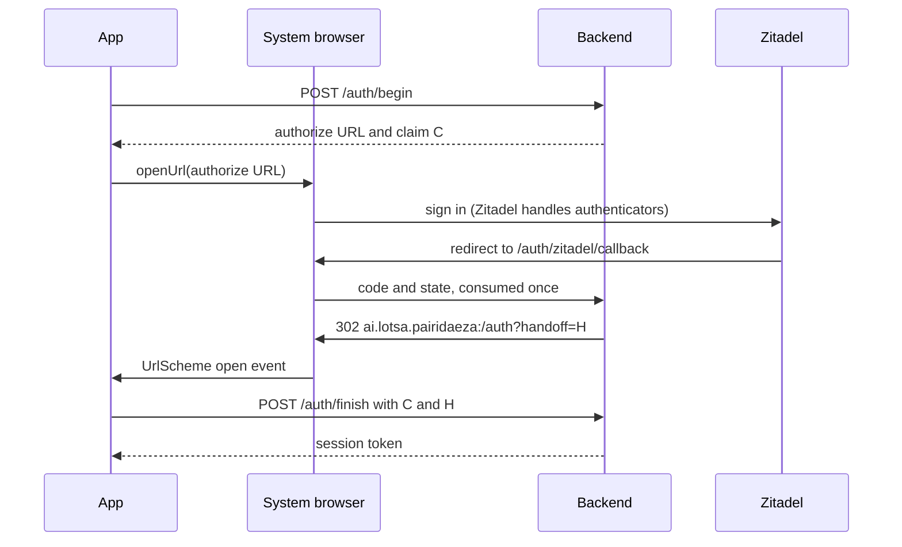

# Onboarding authentication plan

Status: reviewed draft, ready for an executing agent. The executor implements the tasks in order. Check a box only when its evidence exists (a test run, a log line, a screenshot). Reviewed against the repository on 2026-11-10; line references are from that date, so re-read each file before editing it.

## Acceptance bar

The user set this bar. It replaces every earlier authenticator requirement.

- No embedded webview anywhere in sign-in. `nsh.json` never grants the `webview` capability, so NSH cannot show a web page inside the app.
- Follow RFC 8252 for native apps: an external user-agent (system browser, or an OS auth session such as ASWebAuthenticationSession or Custom Tabs), authorization code with PKCE S256, `state` and `nonce` validated, the result delivered only to the app instance that started sign-in, and a reverse-domain private scheme.
- Passkeys, security keys, Touch ID and passwords are handled by Zitadel and the browser. Out of scope: an authenticator matrix, physical-key evidence, forced re-authentication, the passkey domain.

Authentication is not completed onboarding. Provisioning beyond the account below, billing, survey, model setup and first-bot creation stay in the next workstream.

## Fixed inputs

- Issuer `https://auth.lotsa.ai`. Client ID `399106586653524654`. Project ID `399106433292993198`.
- Registered redirect URI `http://127.0.0.1:17810/auth/zitadel/callback`. A probe on 2026-11-10 showed Zitadel accepts it and rejects the backend's current default on port 17800.
- The token endpoint accepts public clients (`token_endpoint_auth_methods_supported` includes `none`), which matches `zitadel.rs` sending no client secret.
- App return scheme `ai.lotsa.pairidaeza` (the `nsh.json` `id`). Return URI `ai.lotsa.pairidaeza:/auth`.
- One dev API daemon on `127.0.0.1:17810` (`mise.toml` `[daemons.api]`). No second server.

## Problems to address

Each problem names its evidence and the task that fixes it.

1. **Native sign-in can be phished (critical, Task 1).** `POST /auth/begin` is unauthenticated and returns the authorize URL plus the claim (`backend/src/auth/routes.rs:74-85`, `mod.rs:148-180`). The callback checks state against a session only for web (`routes.rs:128-137`). `finish` hands the token to whoever presents the claim (`mod.rs:238-260`). An attacker starts a sign-in, sends the URL to a victim, and collects the victim's session after the victim signs in. This breaks the RFC 8252 rule that the result returns only to the app that asked.
2. **Native callback never returns to the app (high, Task 1).** It answers `200 "Signed in. Return to Pairidaeza."` (`routes.rs:146-148`). OS auth sessions finish only on a redirect to the app's callback, and the system browser has no way back to the app.
3. **Callback is not single-use and outcomes are indistinguishable (medium, Task 1).** The native branch keeps the pending entry and overwrites `token` on every callback (`mod.rs:219-225`). A Zitadel refusal leaves the attempt pending (`routes.rs:116-124`). `finish` answers 404 for pending, refused, expired, restarted and wrong claim alike (`mod.rs:236-259`, `routes.rs:173-181`).
4. **The dev daemon cannot run real sign-in (high, Task 3).** `.mise/tasks/dev/api` exports `PAIRIDAEZA_MOCK_AUTH=true`. `serve` refuses mock auth together with a session key (`backend/src/server.rs:87-89`). Without a session key the auth routes answer 503. The default redirect URI uses port 17800 (`backend/src/config.rs:28-32`) while the daemon listens on 17810 (`mise.toml:62`). `client_id` and `project_id` default to empty (`config.rs:24-27`).
5. **Project ID must be configured (high, Task 3).** The backend puts `urn:zitadel:iam:org:project:id:{project_id}:aud` in the scope and accepts `aud` matching client ID or project ID (`zitadel.rs:81-84,154`). `project_id` defaults to empty (`config.rs:26-27`). Set it to `399106433292993198`. Never run real mode with an empty `project_id` in the accepted audiences.
6. **A signed-in user has nothing to load (high, Task 4).** The UI only calls `/api/mock/*` (`api.ts:48,71,119,140,169`), which is mounted only in mock mode (`server.rs:163-165`). Mock identity is hard-coded to owner `u1` and user "Alex Rivera" (`backend/src/mock_api.rs:59-61,191-195`). The mock origin check rejects `https` origins (`mock_api.rs:130-151`). The real RPC module serves only `run.start`, `run.status`, `run.cancel` (`backend/src/rpc.rs:42-83`). No account record exists (`backend/src/auth/backend.rs:12-13`).
7. **The UI fakes sign-in (high, Task 5).** `pages/SignedOut.tsx:8-39` collects an email and password in the app and ignores them. `api.ts:91` creates a session automatically on first launch. The token lives under `pairidaeza.mockSession` (`api.ts:8`). `flush` skips saving when there is no bearer token (`api.ts:134`), so a cookie-only web session would never save. "Delete your account?" only signs out (`pages/Settings.tsx:269-283`).
8. **Tests depend on mock auto sign-in (medium, Task 5).** `test-app.ts` resets through `POST /api/mock/session` (`api-reset-app.tsx:5-9`) and every UI test using it expects boot to reach the Shell without signing in. `account.test.tsx:75-82` presses the fake "Sign in". `api.test.tsx:8-20` stubs `POST */api/mock/session`.
9. **No sign-out route for real sessions (medium, Tasks 1 and 5).** The auth router has `/begin`, `/session`, `/zitadel/callback`, `/finish` only (`routes.rs:20-27`). The native token is a stateless signed token valid 24 hours (`session.rs:39-64`, `config.rs:35-36`) and cannot be revoked server-side.
10. **ID-token validation is weaker than the plan claimed (low, Task 2).** No `azp` check, required claims not enforced, `email_verified` ignored, nonce is a UUIDv7 (`zitadel.rs:145-170`, `mod.rs:155`). No test covers `verify_id_token` (`zitadel.rs:241-249`).
11. **Auth fails open without a session key (low, Task 2).** WebSocket upgrades get `Owner("local-development")` when no session key is set (`server.rs:219-223`), even when mock mode is off.
12. **App links are unproven under `nsh dev` (medium, Task 6).** NSH declares `nsh.json` `"schemes"` to the OS when packaging (`CFBundleURLTypes` on Apple, a `BROWSABLE` intent filter on Android, in the NSH CLI sources). Whether `nsh dev` and the prebuilt iOS dev host (`.nsh/ios/NshDev.app`, bundle id `com.longbridge.nsh.host`, no URL types) route links is not verified. NSH has no auth-session API, so the system browser via `openUrl` is the transport (`.nsh/types/nsh/index.d.ts:333,417-427`).
13. **Web cannot use `openUrl` for sign-in (medium, Task 5).** On web `openUrl` opens a new tab. The cookie flow needs a same-tab navigation to `/auth/begin`. Find the NSH way to navigate the current page; if none exists in TS, report it before adding Rust code.
14. **Phones cannot reach the API (out of scope here).** The backend binds loopback only (`server.rs:84-86`), `nsh.json` network hosts are loopback only, and `dev:ios` targets the simulator. Physical phones need a reachable HTTPS backend; record it as follow-up, do not build it here.
15. **NSH is pinned to a nightly git revision (low).** `Cargo.toml:12-14` pins `nsh-base`/`nsh-core` to `32a6f61f…`; the CLI is `0.4.0 (c5214aa nightly)`. Record the revisions used for Task 6 results. Do not change the pin.

## Native completion design

C stays in app memory. H is random, single-use, and reaches only the device whose browser completed sign-in. Neither works alone. Zitadel keeps one redirect URI. Web keeps its existing same-origin cookie flow.

## Tasks

### Task 1. Bind native completion to the device

Fixes problems 1, 2, 3 and the backend half of 9. Files: `backend/src/auth/mod.rs`, `backend/src/auth/routes.rs`, their tests.

- [ ] The native callback consumes the pending state on first use and answers `302` to `ai.lotsa.pairidaeza:/auth?handoff=<H>`. H is 32 random bytes, base64url.
- [ ] A Zitadel `error` callback marks the attempt failed and redirects to `ai.lotsa.pairidaeza:/auth?error=<code>` with only a fixed code, never provider text.
- [ ] `POST /auth/finish` takes `{ state: C, handoff: H }`, compares both in constant time, and succeeds once. Responses are distinct: pending, failed, expired or unknown. Pick status codes and document them in the route doc comment.
- [ ] Add a sign-out route that removes the web session cookie. Native sign-out is client-side token removal; record server revocation of native tokens as an open item in the README, do not build it.
- [ ] Web flow behavior is unchanged.
- [ ] Tests, each failing before the change: claim without handoff gets no token; handoff without claim gets no token; a replayed callback is rejected and does not replace the token; a second `finish` fails; an expired attempt reports expired; a refused attempt reports failed; the web callback still sets the session and redirects to `/`. Run `mise run test:rust`.

### Task 2. Harden token validation and fail closed

Fixes problems 10 and 11. Files: `backend/src/auth/zitadel.rs`, `backend/src/auth/mod.rs`, `backend/src/server.rs`.

- [ ] `verify_id_token` requires `iss`, `aud`, `exp`, `sub`, checks `azp` equals the client ID when present, and reads `email_verified`. The nonce is random (32 bytes), not a UUID.
- [ ] Without a session key and without mock mode, the server refuses WebSocket upgrades instead of using `Owner("local-development")`. Mock mode keeps today's behavior.
- [ ] Negative tests for a wrong issuer, wrong audience, missing `sub`, wrong nonce, and an upgrade with auth unconfigured. Run `mise run test:rust`.

### Task 3. Run the one dev daemon in real-auth mode

Fixes problems 4 and 5. Files: `.mise/tasks/dev/api`, `mise.toml`, `backend/src/config.rs` (defaults only), `README.md`.

- [ ] One env switch selects mock or real auth for the existing `[daemons.api]`. No second daemon or fixture server.
- [ ] Real mode sets issuer, client ID `399106586653524654`, project ID `399106433292993198`, redirect URI `http://127.0.0.1:17810/auth/zitadel/callback`, and a session key. The IDs are not secrets and may be committed in the task or `mise.toml`. The session key lives in a gitignored local file (check `.gitignore`, for example `mise.local.toml`); never commit it.
- [ ] Real mode refuses to start when client ID or project ID is empty.
- [ ] Evidence: with the daemon in real mode, `GET /auth/begin` answers `302` to `https://auth.lotsa.ai/oauth/v2/authorize` with `redirect_uri=http://127.0.0.1:17810/auth/zitadel/callback`, and Zitadel shows its login page for that URL.
- [ ] `README.md` documents both modes and where the secrets go.

### Task 4. Serve the signed-in user's workspace

Fixes problem 6. Files: `backend/src/workspace.rs`, `backend/src/auth/mod.rs`, `backend/src/server.rs`, tests. Real workspace routes use `/api/workspace`; `backend/src/mock_api.rs` remains unchanged and mock-only.

- [ ] In real mode the workspace document routes accept the real session (browser cookie on web, bearer token on native) and key documents by the authenticated owner (issuer plus `sub`), not `u1`.
- [ ] `user` in the bootstrap response comes from the session identity (`sub`, email, name if present), not the hard-coded fixture.
- [ ] The origin check accepts the configured origin, including `https`.
- [ ] The mock-only `POST /api/mock/session` stays available only in mock mode.
- [ ] Tests: unauthenticated requests get 401; two different `sub` values get separate documents; the bootstrap `user` matches the session. Run `mise run test:rust`.

### Task 5. Replace the fake sign-in in the UI

Fixes problems 7, 8, 13 and the client half of 9. Files: `auth.ts`, `api.ts`, `store.ts`, `App.tsx`, `pages/SignedOut.tsx`, `pages/Settings.tsx`, `nsh.json`, `test-app.ts`, `api-reset-app.tsx`, `account.test.tsx`, `api.test.tsx`. Authentication belongs to `auth.ts`; `api.ts` consumes it for workspace requests.

- [ ] `SignedOut` has no email or password fields. One button starts sign-in in the browser. While waiting it shows a cancel action that returns to the button.
- [ ] Native: `POST /auth/begin`, `openUrl(authorize_url)`, listen with `UrlScheme.on("open")`, accept only `ai.lotsa.pairidaeza:/auth` links, call `finish` with the in-memory claim and the handoff. Links with no matching in-flight attempt are ignored. Errors show a message and a retry.
- [ ] Web: the button navigates the current tab to `/auth/begin`; after the redirect to `/`, boot finds the cookie session. `flush` saves with the cookie when there is no bearer token.
- [ ] No session is created automatically at launch. A failed account load shows the error screen and never shows the Shell.
- [ ] The native token is stored under a new `Storage` key and removed on sign-out. Shortcut accepted by the user: `Storage` is plain app storage, not the keychain.
- [ ] "Delete account" no longer signs out while claiming deletion; hide it until a real delete exists.
- [ ] `nsh.json` adds `"schemes": ["ai.lotsa.pairidaeza"]` and still grants no `webview`.
- [ ] Tests updated: the reset and boot helpers work without mock auto sign-in; `account.test.tsx` covers sign-out then sign-in through `app.openedUrls()` and `app.openWithUrl("ai.lotsa.pairidaeza:/auth?handoff=…")` with stubbed `begin` and `finish`; a link with a foreign scheme or no in-flight attempt does nothing.
- [ ] Run `nsh check`, `nsh build` (read warnings), `nsh test`, then `nsh run` and look at the signed-out screen.

### Task 6. Prove the link round trip per platform

Fixes problem 12.

- [ ] Find which NSH command registers the scheme for a local run on macOS, the iOS simulator and the Android emulator (`nsh dev`, or `nsh package --target … --run`). Record the commands and NSH revisions in `README.md`.
- [ ] On each of the three, opening `ai.lotsa.pairidaeza:/auth?handoff=test` from outside the app (`open` on macOS, `xcrun simctl openurl`, `adb shell am start -a android.intent.action.VIEW -d …`) reaches the app's listener. Evidence: an app log line or screen state per platform.
- [ ] If a platform cannot receive the link with the pinned NSH, stop and report it with the evidence. Do not patch NSH or change dependencies.

### Task 7. Real sign-in end to end

Needs Tasks 1 to 6 and a Zitadel test account (any authenticator Zitadel allows).

- [ ] Web via `mise run dev:web`: sign in, reload stays signed in, sign out returns to the signed-out screen.
- [ ] macOS app: sign in through the system browser, return to the app, restart stays signed in, sign out works.
- [ ] iOS simulator and Android emulator: the same round trip with the API on loopback (`adb reverse` on Android). Physical phones stay out of scope (problem 14).
- [ ] Cancel paths: closing the browser tab leaves the app on a retryable state; a stale or replayed link does nothing.
- [ ] Screenshots per platform. Logs and evidence contain no codes, tokens, claims or handoff values.

## Out of scope and follow-ups

- Physical-phone sign-in: needs a reachable HTTPS backend and signed device builds.
- OS auth sessions (ASWebAuthenticationSession, Custom Tabs, Auth Tab) and keychain storage: need app-owned native code and user approval for `src/lib.rs` and `Cargo.toml` changes. RFC 8252 recommends them for usability, not as a requirement.
- Server-side revocation of native tokens.
- Real account deletion, billing, survey, model setup, first bot.

## References

- [RFC 8252](https://www.rfc-editor.org/rfc/rfc8252): section 8.12 forbids embedded user-agents; sections 7.1 and 8.4 cover reverse-domain schemes.
- NSH links: `.nsh/types/nsh/index.d.ts` (`openUrl`, `UrlScheme`), `.nsh/types/nsh/test.d.ts` (`openWithUrl`, `openedUrls`, `urlScheme`).
- Zitadel discovery: `https://auth.lotsa.ai/.well-known/openid-configuration`.
